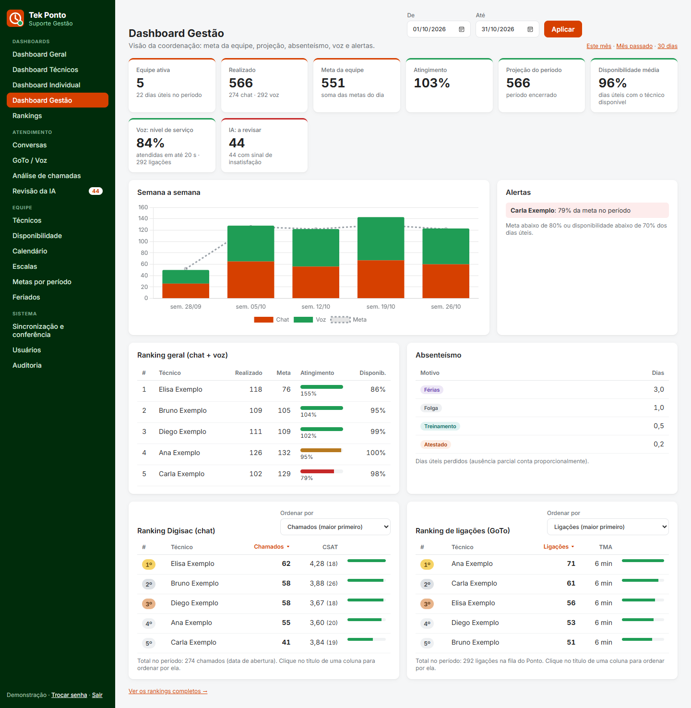
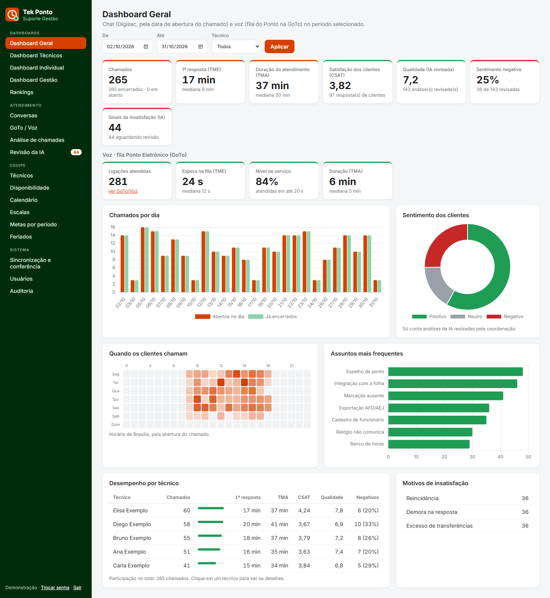
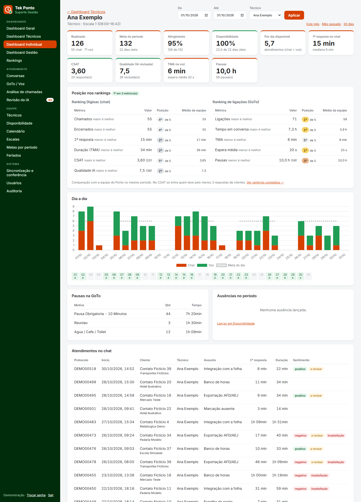
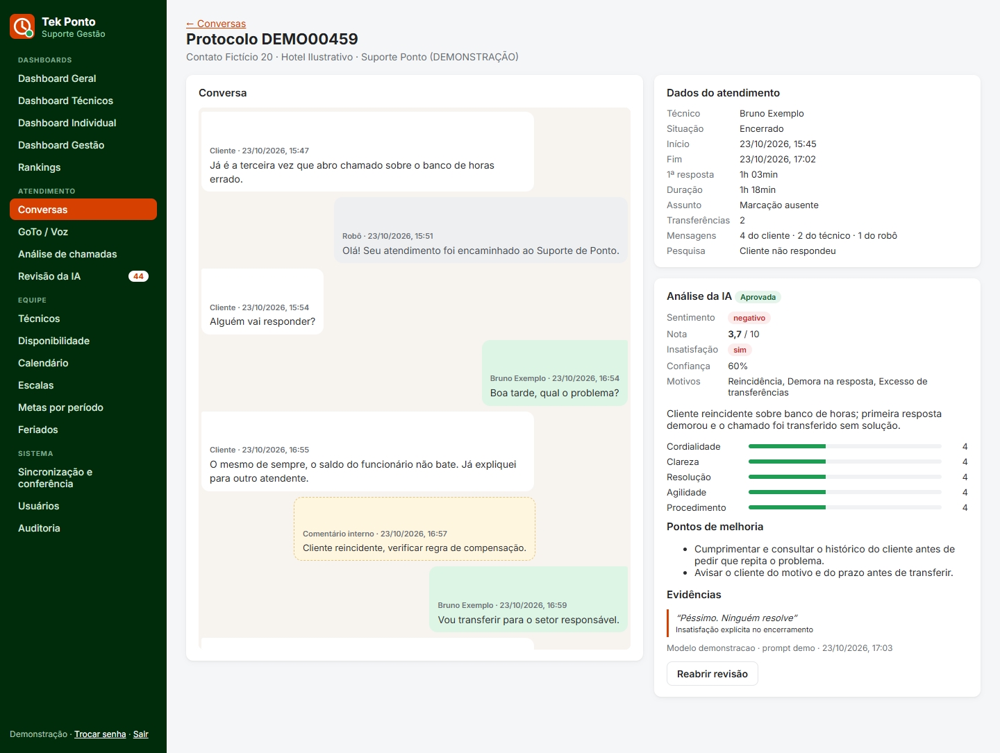
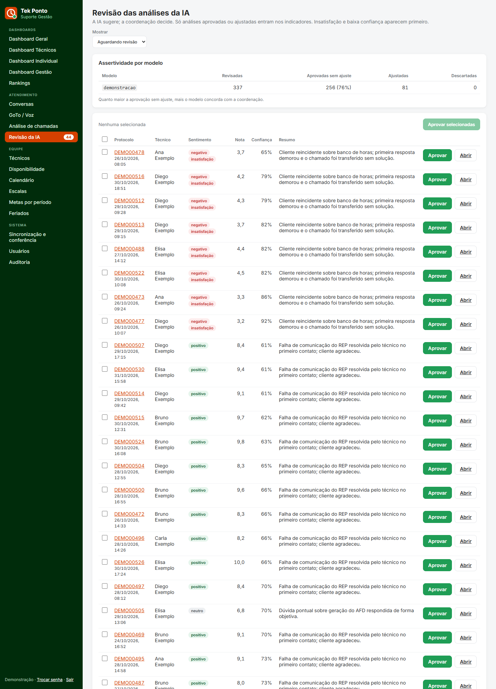
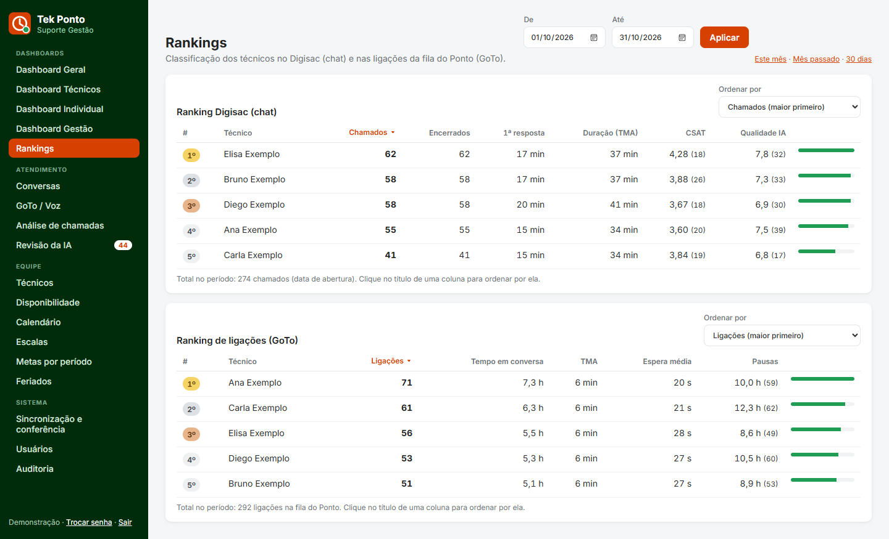
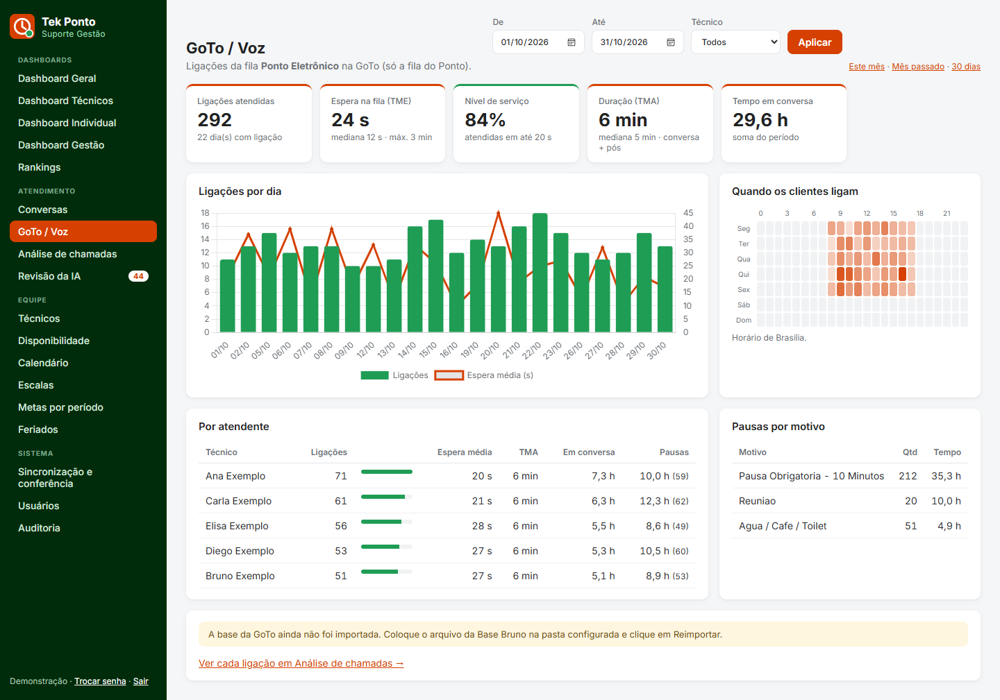
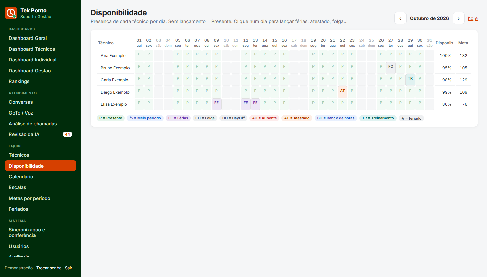
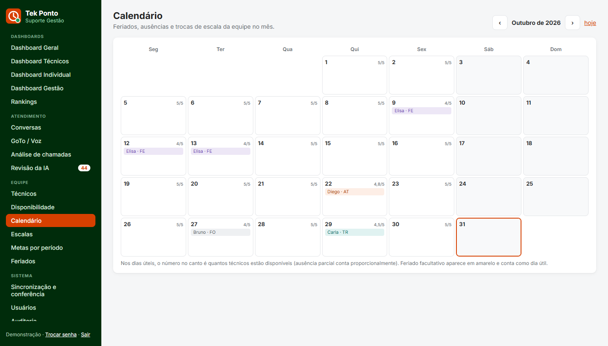
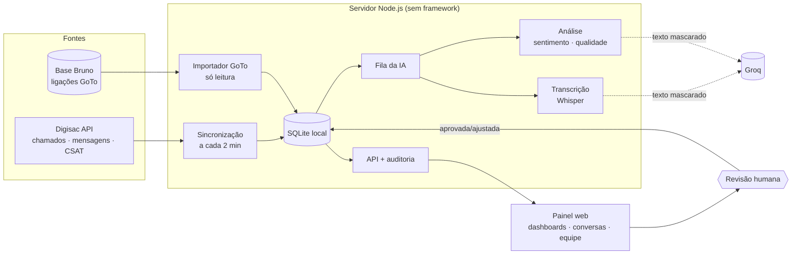

<div align="center">


# Tek Ponto · Suporte Gestão

**Indicadores, gestão da equipe e análise de qualidade com IA para o Suporte de Ponto Eletrônico da Tek Norte.**
Chat do **Digisac** e voz da **GoTo** num só painel, com revisão humana em toda avaliação feita pela IA.

[](https://nodejs.org)
[](https://nodejs.org/api/sqlite.html)
[](https://documenter.getpostman.com/view/24605757/2sA3BhfaDg)
[](#-voz-goto)
[](#-inteligência-artificial)
[](#-segurança-e-lgpd)
[](#-testes-e-comandos)

[Funcionalidades](#-funcionalidades) · [Telas](#-telas) · [Começando](#-começando) · [Arquitetura](#-arquitetura) · [Indicadores](#-como-os-indicadores-são-calculados) · [IA](#-inteligência-artificial) · [LGPD](#-segurança-e-lgpd)

<br>



<sub>Todas as capturas usam dados fictícios gerados por <code>npm run demo</code>.</sub>

</div>

---

## ✨ O que é

O Tek Ponto · Suporte Gestão reúne em um painel web tudo o que a coordenação do Suporte de Ponto precisa acompanhar:

- **Atendimentos do Digisac (chat)** sincronizados pela API a cada 2 minutos: conversas completas, com áudio, vídeo e imagem.
- **Ligações da GoTo (voz)** da fila *Ponto Eletrônico*: espera, duração, nível de serviço e pausas.
- **Produtividade de cada técnico**: meta × realizado (chat + voz), disponibilidade, escalas, feriados e rankings.
- **IA que lê cada atendimento encerrado**, inclusive o que foi falado nos áudios, e sugere sentimento, sinais de insatisfação e nota de qualidade. **Nada vira indicador sem a aprovação de uma pessoa.**

Roda em qualquer Windows com Node.js, sem Docker e sem banco externo: o banco é um arquivo SQLite local.

## 🧭 Funcionalidades

<table>
<tr><th>Área</th><th>Telas</th><th>Destaques</th></tr>
<tr><td><b>📊 Dashboards</b></td>
<td>Geral · Técnicos · Individual · Gestão · Rankings</td>
<td>KPIs de chat e voz, mapa de calor, meta × realizado, projeção do período, absenteísmo, alertas, ranking Digisac e de ligações (top 3 em destaque, ordenável por qualquer métrica) e a posição de cada técnico em cada métrica</td></tr>
<tr><td><b>💬 Atendimento</b></td>
<td>Conversas · GoTo/Voz · Análise de chamadas · Revisão da IA</td>
<td>Conversa com player de áudio/vídeo e transcrição automática, busca que inclui o que foi falado, cada ligação com espera e duração, CSV, revisão das análises uma a uma ou em lote</td></tr>
<tr><td><b>👥 Equipe</b></td>
<td>Técnicos · Disponibilidade · Calendário · Escalas · Metas por período · Feriados</td>
<td>Cadastro com função e vínculo GoTo ↔ Digisac, grade mensal de presença (férias, atestado parcial por horário...), escalas com histórico, meta diária com vigência, feriados por tipo</td></tr>
<tr><td><b>⚙️ Sistema</b></td>
<td>Sincronização e conferência · Usuários · Auditoria</td>
<td>Conferência dos números contra a estatística oficial do Digisac, perfis de acesso, trilha de auditoria de tudo que é lido ou alterado</td></tr>
</table>

**Perfis:** *administrador* e *coordenação* veem tudo. O *técnico* vê só os próprios atendimentos, o próprio dashboard (com a posição dele nos rankings, sem os números dos colegas) e as próprias ausências no calendário.

## 🖼️ Telas

<table>
<tr>
<td width="50%"><br><b>Dashboard Geral</b>: chat e voz no período, sentimento revisado, mapa de calor, assuntos e técnicos.</td>
<td width="50%"><br><b>Dashboard Individual</b>: KPIs, posição em cada ranking, dia a dia × meta, presença e pausas.</td>
</tr>
<tr>
<td><br><b>Conversa</b>: robô, comentários internos e mídias destacados; análise da IA com evidências.</td>
<td><br><b>Revisão da IA</b>: insatisfação e baixa confiança primeiro; aprovar em lote, ajustar ou descartar.</td>
</tr>
<tr>
<td><br><b>Rankings</b>: Digisac e ligações, ordenáveis por volume, tempo de resposta, CSAT, qualidade, TMA...</td>
<td><br><b>GoTo / Voz</b>: fila do Ponto: ligações, espera, nível de serviço, por hora, por atendente, pausas.</td>
</tr>
<tr>
<td><br><b>Disponibilidade</b>: grade mês × técnico; ausência parcial calculada pela jornada.</td>
<td><br><b>Calendário</b>: feriados, ausências, trocas de escala e quantos técnicos estão disponíveis.</td>
</tr>
</table>

## 🚀 Começando

**Pré-requisito:** [Node.js](https://nodejs.org) 22.5 ou mais novo (testado no 24).

```bash
git clone https://github.com/rodolfocaetanotek/TekPontoSuporte.git
cd TekPontoSuporte
npm install
copy .env.exemplo .env          # preencha DIGISAC_URL, DIGISAC_TOKEN e GROQ_API_KEY
npm run usuario -- --admin      # cria o primeiro administrador
npm start                       # ou dois cliques em painel.cmd  →  http://localhost:4250
```

Com o Digisac configurado, a primeira sincronização começa 5 s depois que o servidor sobe. Ela traz os últimos 90 dias e, depois disso, roda a cada 2 minutos. Em **Sincronização e conferência**, escolha os departamentos monitorados.

> **Só quer conhecer a interface?** `npm run demo` gera chamados, ligações, metas e ausências **fictícios** e um usuário `demo@tekponto.local` (a senha aparece no terminal). Remova com `npm run demo -- --limpar` antes de ligar o Digisac.

<details>
<summary><b>Rodar sem deixar o painel aberto</b></summary>

Aponte o Agendador de Tarefas do Windows para `sincronizar.cmd`. Ele sincroniza, espera a fila da IA terminar e encerra.
</details>

## ⚙️ Configuração

Tudo fica no arquivo `.env` (modelo em [`.env.exemplo`](.env.exemplo)). Os principais:

| Variável | Para quê | Padrão |
|---|---|---|
| `DIGISAC_URL` / `DIGISAC_TOKEN` | Conta e token pessoal do Digisac (Configurações › Tokens) | — |
| `SINCRONIZAR_A_CADA_MINUTOS` | Intervalo da sincronização incremental | `2` |
| `IA_PROVEDOR` | `groq` (nuvem, gratuito) · `ollama` (local) · `anthropic` (Claude, pago) | `groq` |
| `GROQ_API_KEY` | Chave do [Groq](https://console.groq.com) para análise e transcrição | — |
| `IA_MODELO` | Modelo de análise | `openai/gpt-oss-120b` |
| `IA_TRANSCREVER_MIDIA` | Transcrever áudios e vídeos antes da análise | `sim` |
| `BASE_GOTO_PASTA` / `BASE_GOTO_FILA` | Pasta do banco com as ligações da GoTo e a fila importada | `Ponto Eletrônico` |
| `RETENCAO_MENSAGENS_DIAS` | Dias que o texto das conversas fica guardado (LGPD) | `365` |
| `HOST` / `PORTA` | Endereço do painel (`127.0.0.1` = só esta máquina) | `127.0.0.1:4250` |

## 🏗️ Arquitetura



- **Sincronização incremental** por `updatedAt`, com repetição em erro 429/5xx e renovação do token. A IA tem fila própria e nunca segura a sincronização.
- **Mídias** (áudio, vídeo, imagem) continuam no Digisac: o servidor busca o link assinado na hora e repassa o conteúdo ao navegador, sem gravar arquivo.
- **Interface** em HTML/CSS/JS puro, com [Chart.js](https://www.chartjs.org) e CSP restritiva.

## 📏 Como os indicadores são calculados

As regras estão em `src/indicadores.mjs` e `src/gestao.mjs`, cobertas por `test/regras.test.mjs`.

<details>
<summary><b>💬 Chat (Digisac)</b></summary>

- **Período**: pela data de **abertura** do chamado, em horário de Brasília.
- **1ª resposta (TME)**: tempo que o cliente esperou por um humano. Começa na última mensagem do robô (menu) antes do técnico, ou na 1ª mensagem do cliente se não houve robô, e termina na 1ª mensagem de um técnico. Comentários internos, reações e mensagens do sistema não contam. Contato ativo (o técnico escreveu primeiro) e chamado sem resposta humana ficam vazios, não zero.
- **Duração (TMA)**: do início ao encerramento; só chamados encerrados.
- **Técnico do chamado**: quem estava com ele por último (`userId` no Digisac). Transferências são contadas, mas o chamado não é dividido entre técnicos.
- **CSAT**: média das notas 1–5 **dadas pelos clientes**. O Digisac também gera notas pela IA dele (`aiGenerated`); elas aparecem só como referência e **não entram no CSAT**. Notas inválidas (`-1`, `no_human_context`) são ignoradas.
- **Sentimento, qualidade e motivos**: só contam análises **aprovadas ou ajustadas** por uma pessoa.
- **Departamentos**: só os marcados como monitorados. Os filtros aceitam vários.
</details>

<details id="-voz-goto">
<summary><b>📞 Voz (GoTo)</b></summary>

- Importada da **Base Bruno** (`BASE_GOTO_PASTA`), o banco SQLite do sistema de gestão das outras áreas, que recebe as ligações da API da GoTo. O arquivo mais recente da pasta é aberto **só para leitura** e reimportado sozinho quando muda (ou `npm run importar-goto`).
- **Importado**: ligações da fila `BASE_GOTO_FILA`, pausas dos atendentes dessa fila, escalas-padrão e feriados. Escalas e feriados só completam o que falta: edições feitas no painel prevalecem.
- **Não importado, de propósito**: salários, senhas, feedbacks de RH e dados das outras áreas. Abandonos também ficam de fora, porque na base eles não indicam a fila.
- **Espera (TME)** = tempo na fila; **TMA** = conversa + pós-atendimento; **nível de serviço** = atendidas em até 20 s.
- **Vínculo GoTo ↔ Digisac** pelo nome, sem acento: mesmo primeiro nome e todas as partes do nome mais curto contidas no mais longo ("Carlos Souza" = "Carlos Eduardo Lima Souza"). Dá para corrigir em **Técnicos**.
- A tela avisa quando há dias úteis sem nenhuma ligação na base.
</details>

<details>
<summary><b>👥 Gestão da equipe</b></summary>

- **Dia útil**: segunda a sexta que não é feriado ativo. Feriado *facultativo* conta como útil.
- **Disponibilidade**: sem lançamento = Presente (100%). Meio período = 50%; férias, folga, DayOff e ausente = 0. Atestado, banco de horas e treinamento podem ser parciais: fração = 1 − horas ausentes ÷ jornada (padrão 7h12; 1h30 → 79%). Um período (ex.: férias) é lançado só nos dias úteis.
- **Meta do dia** = meta do dia lançada na disponibilidade, ou meta vigente (*Metas por período*, senão a meta padrão do técnico) × fração disponível. **Sem meta cadastrada não há atingimento**: o sistema não inventa meta.
- **Realizado** = chamados do Digisac encerrados no dia + ligações atendidas na fila do Ponto.
- **Projeção**: realizado + ritmo médio dos dias úteis passados × dias úteis restantes.
- **Alertas**: atingimento < 80% ou disponibilidade < 70% dos dias úteis.
- **Rankings**: CSAT só classifica quem tem 3+ respostas de clientes; quem tem função **Apoio** não entra (`FUNCOES_FORA_DO_RANKING`).
</details>

<details>
<summary><b>✅ Validação contra o Digisac</b></summary>

Em **Sincronização e conferência › Conferir indicadores**, os números locais aparecem lado a lado com `GET /api/v1/dashboard/general` no mesmo período, e cada conferência fica registrada. Diferença na contagem de chamados indica sincronização incompleta. As médias de tempo do Digisac dividem pelo total de chamados, **inclusive os abertos**; por isso a duração média de lá é menor que a nossa, que considera só encerrados. Por chamado, a duração bate com `metrics.ticketTime`.
</details>

## 🤖 Inteligência Artificial

Para cada chamado **encerrado**, a IA recebe a conversa (com os áudios e vídeos já transcritos) e devolve um JSON validado por esquema: sentimento, intensidade, insatisfação, motivos (lista fechada), nota 0–10, cinco critérios (cordialidade, clareza, resolução, agilidade, procedimento), resumo, pontos de melhoria, evidências literais e confiança. O prompt instrui a não penalizar o técnico por fatores fora do controle dele e a baixar a confiança em conversas curtas ou ambíguas.

| Provedor | Onde roda | Custo | Velocidade |
|---|---|---|---|
| **`groq`** (padrão) · `openai/gpt-oss-120b` + Whisper | nuvem | plano gratuito | ~2 s por análise |
| `ollama` · Qwen3 8B/14B | este computador (portátil, em `.tools/`) | gratuito | minutos por análise sem placa de vídeo |
| `anthropic` · Claude | nuvem | pago | segundos |

<details>
<summary><b>Como funciona a análise automática</b></summary>

- Cada chamado encerrado entra na fila da IA logo após a sincronização. **Sem retroativo**: só entram os encerrados depois que a análise automática foi ligada. "Analisar agora", na conversa, coloca o chamado na frente da fila, inclusive um antigo.
- **Áudios e vídeos** são transcritos pelo Whisper (`whisper-large-v3-turbo`, português): o arquivo passa só pela memória e só o texto é salvo. A transcrição aparece no balão da conversa e entra na busca.
- Ao atingir a cota gratuita, a fila pausa e retoma sozinha no ciclo seguinte. Uma chave inválida para a fila, em vez de marcar falha em cada chamado.
- `npm run comparar-ia` compara modelos nas mesmas conversas reais contra a nota que o próprio cliente deu, sem gravar análises.
</details>

<details>
<summary><b>Revisão humana e rastreabilidade</b></summary>

- Toda análise nasce **pendente**. Ajustar ou descartar exige justificativa; tudo vai para a auditoria com o valor anterior. Uma análise revisada não é sobrescrita (é preciso reabrir a revisão).
- Técnicos só veem avaliações já revisadas.
- Cada análise guarda o modelo, a versão do prompt e a data. O placar por modelo, em **Revisão da IA**, mostra quanto a coordenação aprovou sem ajuste.
- Falhas ficam registradas com o motivo e são tentadas de novo após 1 dia.
</details>

## 🔒 Segurança e LGPD

- **Acesso**: senha com hash scrypt, sessão em cookie `HttpOnly; SameSite=Strict`, bloqueio após 5 senhas erradas em 15 min. Por padrão o servidor só escuta em `127.0.0.1`.
- **Perfis e escopo**: o técnico vê só o que é dele; a observação de um atestado só a coordenação vê.
- **Auditoria**: logins (inclusive falhas), abertura de cada conversa e de cada mídia, revisões da IA, exportações, conferências e qualquer alteração de cadastro, meta, escala, disponibilidade ou feriado.
- **Minimização para a IA**: CPF, CNPJ, telefones e e-mails são mascarados antes do envio (inclusive o que foi falado nos áudios), e o nome do cliente não é enviado. No Groq, ligue **Zero Data Retention** (Settings › Data Controls); os termos proíbem treinar modelos com os dados enviados.
- **Retenção**: o texto das conversas e as transcrições são apagados após `RETENCAO_MENSAGENS_DIAS`; métricas e análises permanecem.
- **Segredos** ficam só no `.env`, fora do versionamento. CSP, `X-Frame-Options` e `nosniff` em todas as respostas.

<details>
<summary><b>🔌 Endpoints do Digisac usados</b></summary>

Referência: <https://documenter.getpostman.com/view/24605757/2sA3BhfaDg> · cliente em `src/digisac.mjs`.

| Uso | Endpoint |
|---|---|
| Autenticação | token pessoal (Bearer) ou `POST /api/v1/oauth/token` |
| Técnicos / departamentos | `GET /api/v1/users`, `GET /api/v1/departments` |
| Chamados (incremental) | `GET /api/v1/tickets?query={where, include}` |
| Mensagens e mídias | `GET /api/v1/messages?query={where: {ticketId}, include: [file]}` |
| Pesquisa de satisfação | `GET /api/v1/answers`, `GET /api/v1/questions` |
| Conferência | `GET /api/v1/dashboard/general` |
</details>

## 🗂️ Estrutura do projeto

```
src/
  server.mjs         API HTTP, permissões, arquivos da interface
  rotas-gestao.mjs   rotas de dashboards, rankings, voz e equipe
  sync.mjs           sincronização incremental com o Digisac, retenção
  digisac.mjs        cliente da API do Digisac
  base-goto.mjs      importador da Base Bruno (ligações da GoTo)
  indicadores.mjs    regras dos indicadores de chat
  gestao.mjs         dias úteis, disponibilidade, metas, produção, voz
  ia.mjs             fila e análise da IA, mascaramento LGPD
  transcricao.mjs    transcrição de áudio/vídeo (Whisper)
  auth.mjs           senhas, sessões, perfis
  db.mjs             esquema SQLite e auditoria
  demo.mjs           dados fictícios
web/                 interface (HTML, CSS e JS sem framework)
test/                testes (node --test)
docs/img/            capturas de tela (dados fictícios)
```

## 🧪 Testes e comandos

| Comando | O que faz |
|---|---|
| `npm start` | sobe o painel em `http://localhost:4250` |
| `npm test` | roda os 19 testes das regras (indicadores, IA, LGPD, gestão) |
| `npm run usuario -- --admin` | cria ou redefine um usuário |
| `npm run sincronizar` / `sincronizar:completo` | sincroniza com o Digisac pelo terminal |
| `npm run importar-goto` | importa a base da GoTo agora |
| `npm run analisar` | processa a fila da IA |
| `npm run comparar-ia` | compara modelos de IA em conversas reais |
| `npm run departamentos` | lista os departamentos do Digisac |
| `npm run demo` / `npm run demo -- --limpar` | gera ou remove os dados de demonstração |

---

<div align="center">
<sub>Feito para a equipe de Suporte de Ponto Eletrônico da <b>Tek Norte</b>.</sub>
</div>
